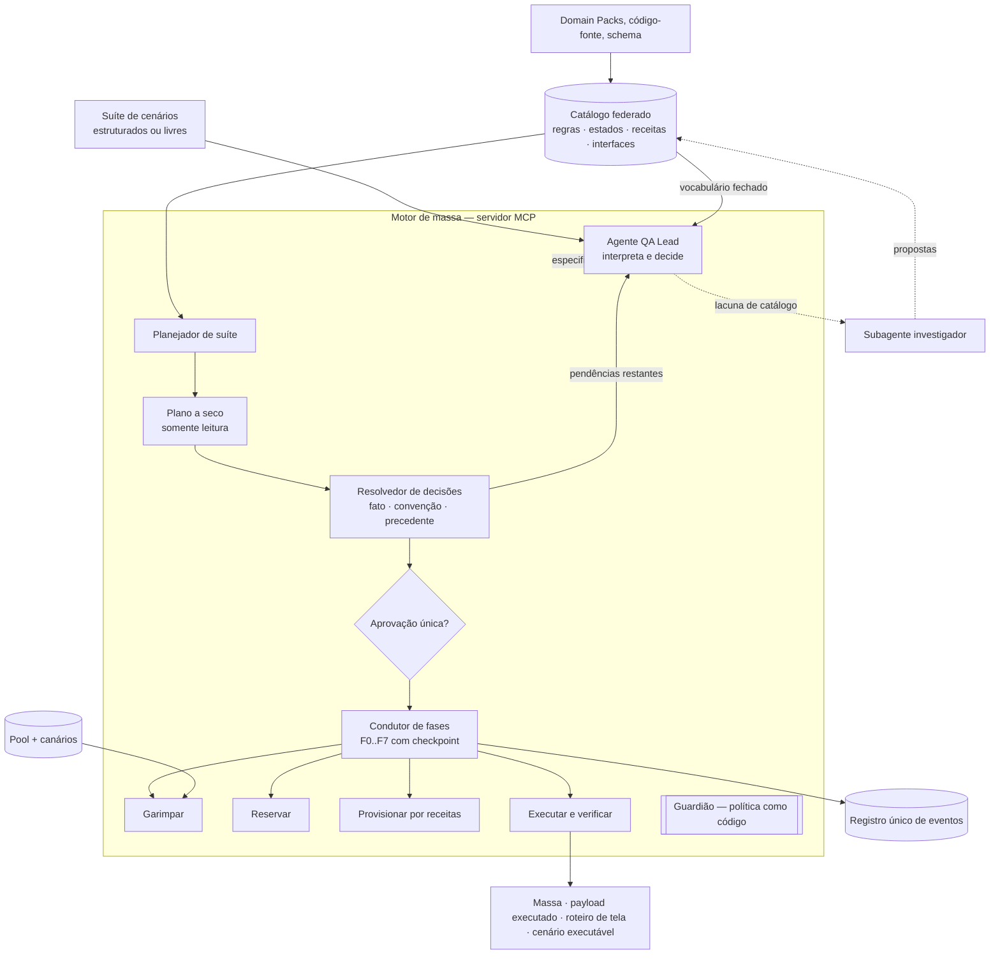

# Arquitetura — Fábrica de Massa de Testes (v3)

## Princípios

1. O modelo interpreta e decide **o que** testar; o motor determinístico decide **os valores** e **as ações**.
2. Conhecimento é montado antes (catálogo versionado), não descoberto a cada pedido.
3. Toda decisão é tomada antes de qualquer escrita (plano a seco); a execução roda sem interrupção.
4. Pré-condição (precisa existir e ser válida no banco) é diferente de dado de entrada (pode ser inválido, vive no payload).
5. Toda expectativa de resultado declara a origem: funcional, técnica ou premissa.
6. Um único registro de eventos, somente-acréscimo; checkpoint, auditoria e precedentes são projeções dele.
7. A política de segurança (Guardião) é aplicada no servidor, não depende do cliente.

## Visão geral

## Camadas

| Camada | Usa IA? | Responsabilidade |
|---|---|---|
| QA Lead (agente) | Sim | Interpretar cenários com vocabulário fechado; decidir pendências a partir do degrau 4 da escada |
| Investigador (subagente) | Sim | Propor estados/regras/receitas faltantes, com evidência, para revisão humana |
| Catálogo | Não | Regras com fonte, estados, receitas e interfaces; montado no build, versionado |
| Motor (MCP) | Não | Planejar, simular, decidir degraus 1–3, executar, verificar, registrar |
| Guardião | Não | Política única aplicada dentro do servidor; falha fechada |
| Hooks | Não | Isolar o agente (só MCP), injetar contexto, sanitizar entrada, auditar |
